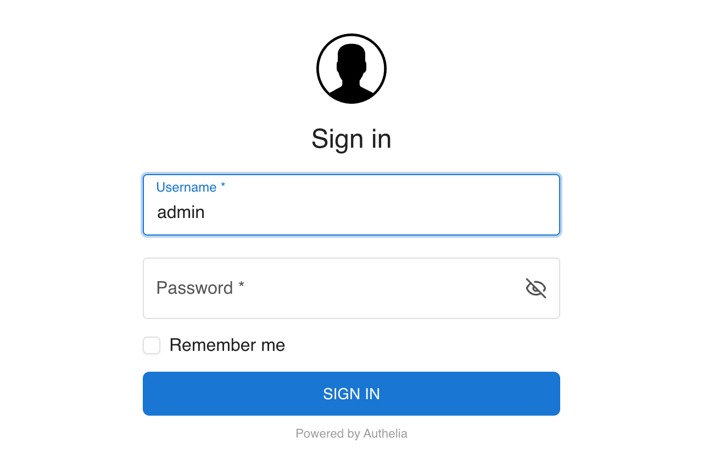
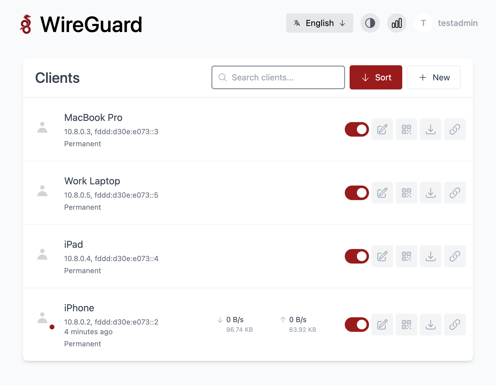
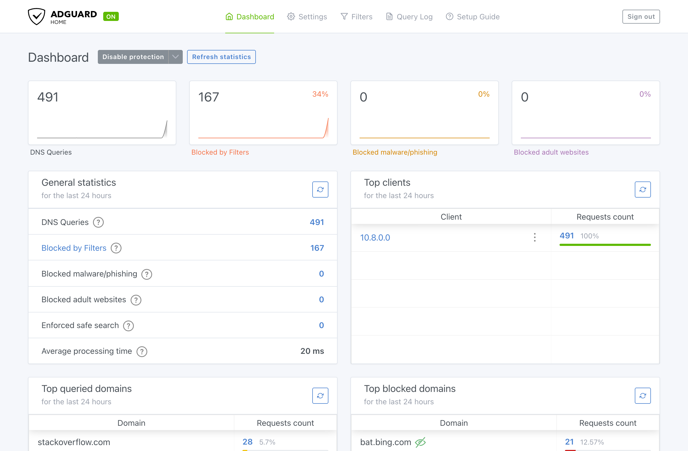

<div align="center">

# 🛡️ WireGuard VPN Server

**Your own private, ad-blocking VPN on any cheap VPS, deployed with one command.**

[](https://github.com/KidA001/automated-wireguard-vpn-install/actions/workflows/ci.yml)


[Quick start](#-quick-start) •
[Features](#-features) •
[After deploying](#-after-deploying) •
[Operations](#-operations) •
[Rebuilding](#-rebuilding-from-scratch) •
[Development](#-development--testing)

</div>

An interactive wizard asks a few questions, then sets up a hardened server running WireGuard, network-wide ad
blocking, your own recursive DNS resolver, and a two-factor sign-in page that protects every web UI. No logs, and
nightly self-updates.

<table>
  <tr>
    <td align="center" width="33%"></td>
    <td align="center" width="33%"></td>
    <td align="center" width="33%"></td>
  </tr>
  <tr>
    <td align="center"><b>Single sign-on with 2FA</b><br><sub>Authelia guards every web UI</sub></td>
    <td align="center"><b>Add devices in seconds</b><br><sub>wg-easy: scan a QR code and you're connected</sub></td>
    <td align="center"><b>Ad &amp; tracker blocking</b><br><sub>AdGuard Home on every device, no app needed</sub></td>
  </tr>
</table>

## ✨ Features

| | |
|---|---|
| 🔒 **WireGuard VPN** | Fast, modern VPN with the [wg-easy](https://github.com/wg-easy/wg-easy) web UI for managing devices |
| 🚫 **Ad, tracker & malware blocking** | AdGuard Home, with Minimal / Balanced / Aggressive blocklist profiles |
| 🌐 **Private DNS** | Unbound recursive DNSSEC resolver. No Google, Cloudflare or other third-party DNS |
| 🔑 **Single sign-on + 2FA** | Authelia with **TOTP** (and optional passkeys) in front of every web UI |
| 📜 **Automatic HTTPS** | Caddy with Let's Encrypt certificates |
| 🙈 **No logging** | No DNS query log, no access logs, RAM-only system journal and `/var/log` |
| 🔄 **Nightly updates** | OS and container updates with rollback, auto-reboot, and an optional email alert on failure |
| 🧱 **Hardened by default** | Key-only SSH (recommended), default-deny nftables firewall, and fail2ban |
| ☁️ **Any domain, any DNS provider** | Optional automatic DNS records on Cloudflare |
| ♻️ **Painless rebuilds** | Optionally keeps the server's identity in your local encrypted vault, so a rebuilt VPS needs no changes on your devices. Full encrypted backups are opt-in |


## 📋 Requirements

<table>
<tr>
<td valign="top" width="33%">

**🖥️ VPS**
- Fresh **Debian 13 (trixie)**, x86_64 or arm64
- At least 1 vCPU, 1 GB RAM, 10 GB disk (**2 GB recommended**, especially with the Aggressive blocklist profile)
- Public IPv4 (IPv6 optional but recommended)
- SSH access as root with either a password (only used once) or a key you have already added

VPS Hosts I've tested with:  
[Bluehost](https://www.bluehost.com)  
[RackNerd](https://www.racknerd.com)

</td>
<td valign="top" width="33%">

**💻 Your machine** (macOS or Linux)
- `ssh`, `python3`, `dig`
- [`uv`](https://docs.astral.sh/uv/) (the deploy script offers to install it)

</td>
<td valign="top" width="33%">

**🌐 Domain**
- Any domain (or delegated subdomain zone) whose DNS you control, at any DNS provider
- **Cloudflare users** can optionally give an API token so the script creates the records for you ([see below](#optional-cloudflare-api-token))

</td>
</tr>
</table>

## 🚀 Quick start

```bash
git clone https://github.com/KidA001/automated-wireguard-vpn-install.git
cd automated-wireguard-vpn-install
./deploy.sh
```
  

### What it asks

Every prompt shows a recommended default. Answers are saved to the gitignored `config/` folder and pre-filled on
re-runs. Secrets are encrypted with ansible-vault, and the vault password is kept in your OS keychain.

**Always asked**

1. VPS IP address
2. Admin username and sudo password (generated for you by default)
3. Your domain. The DNS provider is detected and you confirm it. Cloudflare only: optional API token, so the deploy can create the DNS records for you.
4. VPN namespace label (default `vpn` → `vpn.<domain>`, `auth.vpn.<domain>`, …)
5. Whether your SSH key is already on the VPS or to sign in as root with password and add your key
6. Disable SSH password login? (**strongly recommended**; root SSH login is always disabled)
7. Web login password (you sign in with your admin username + this + an authenticator code)
8. Timezone (defaults to your computer's timezone)
9. Ad-blocking profile: Minimal / **Balanced** / Aggressive
10. Email alert if the nightly update fails? (optional, free [Healthchecks.io](https://healthchecks.io) check: period 1
    day, grace 2 hours)

<details>
<summary><b>Advanced settings (optional)</b></summary>

Advanced settings (can skip and use defaults):
- SSH and WireGuard ports
- Maintenance time (default 2:00 AM) and auto-reboot
- Subdomain labels
- IPv6 mode
- Client isolation
- iCloud Private Relay blocking
- Encrypted-DNS bypass blocking
- AdGuard statistics
- "Remember me" duration
- Passkeys
- Keep the server identity in your vault (default on)
- Full encrypted backups (default off)
- fail2ban

</details>

### What it does

1. 🔐 Shows the server's host-key fingerprint for you to confirm and pins it.
2. 👤 Creates your admin user and verifies key login works. Then it disables root SSH login, and password login if you
   chose that.
3. 🌐 Sets up DNS records:
   - **Cloudflare with a token:** shows exactly which records it will create or change and only writes them after you
     confirm.
   - **Anything else:** prints the records for you to add.

   Then it waits until they resolve.
4. 📦 Installs and configures everything, then runs verification checks.

Re-run `./deploy.sh` at any time. It is idempotent.

**Useful flags**

| Flag | What it does |
|------|--------------|
| `--staging` | Use Let's Encrypt test certificates. Use this while experimenting, to avoid rate limits |
| `--non-interactive` | Reuse the saved answers with no prompts |
| `--reconfigure` | Ask every question again |
| `--tags <role>` | Re-apply only some components |
| `--check` | Dry run, showing what would change. It only works on a server that's already set up |
| `--show-totp` | Show the authenticator QR code again |

## 🌐 DNS records

Shown with the default `vpn` namespace. Replace the IPs with your VPS's.

> [!IMPORTANT]
> If your provider can proxy traffic (e.g. Cloudflare's orange cloud), set every record to **DNS only**.

| Type | Name | Value |
|------|------|-------|
| A | `vpn` | VPS IPv4 |
| AAAA | `vpn` | VPS IPv6 (if available) |
| CNAME | `auth.vpn` | `vpn.<your-domain>` |
| CNAME | `wg.vpn` | `vpn.<your-domain>` |
| CNAME | `adguard.vpn` | `vpn.<your-domain>` |

Recommended manual steps (never automated):
- Turn on **DNSSEC** for the zone. If your registrar is not your DNS provider, also add the DS record at the registrar.
- Add **CAA** records allowing only `letsencrypt.org` and `sectigo.com` to issue certificates.

### Optional: Cloudflare API token

Create a token so `deploy.sh` can manage the records above:

1. Go to Cloudflare dashboard → **My Profile → API Tokens → Create Token → Create Custom Token**.
2. Set permissions to **Zone → DNS → Edit**.
3. Set zone resources to **Include → Specific zone → your domain**.
4. Create the token and paste it when `deploy.sh` asks.

The token is stored only in the encrypted vault on your machine and is never copied to the VPS. The script never
deletes records and always asks before it changes anything.

## 🎉 After deploying

| URL | Purpose |
|-----|---------|
| `https://auth.vpn.<domain>` | Sign in: username, password, then a code from your authenticator app |
| `https://wg.vpn.<domain>` | Manage WireGuard devices (signs you in automatically after Authelia) |
| `https://adguard.vpn.<domain>` | Manage ad blocking (no second login) |

## Wireguard
Download the [Wireguard](https://www.wireguard.com/install/) app for your phone and machine

### First sign-in

1. At the end of the first deploy, `deploy.sh` shows a **QR code** in your terminal. Scan it with your authenticator
   app (1Password, Google Authenticator, Aegis, …). To see it again, run `./deploy.sh --show-totp`.
2. Open `https://wg.vpn.<domain>`. Sign in with your admin username and web login password, then the 6-digit code.
3. Add a device and scan its QR code with the WireGuard app. Then check [ipleak.net](https://ipleak.net) and the
   extended test at [dnsleaktest.com](https://dnsleaktest.com).
4. Optionally, register a **passkey** (Touch ID, Face ID, security key):
   1. Open `https://auth.vpn.<domain>` and go to **Settings → Two-Factor Authentication**.
   2. Authelia asks for a one-time code, which it writes on the server because no email is configured. Get it with
      `ssh -t vpn sudo vpn-status --auth-code`

### Good to know

- ⏱️ Sessions end after 1 hour idle or 12 hours, unless you tick "remember me" (30 days).
- 🚷 Three wrong sign-ins from one address block that address for an hour. Five also trigger a firewall ban. If you
  lock yourself out, run `ssh -t vpn sudo vpn-unban <your-ip>`.
- ✏️ AdGuard settings changed in its web UI are overwritten on the next deploy. Put allowlist or custom rules in
  `config/settings.yml` instead, for example:

  ```yaml
  adguard_custom_rules:
    - "@@||example.com^"   # always allow example.com
  ```

<details>
<summary><b>🧯 Break-glass: when something breaks</b></summary>

- **wg-easy single sign-on breaks:** `ssh -t vpn sudo vpn-breakglass wg-easy` turns its password login back on until
  the next deploy or reboot.
  1. Run `ssh -N -L 51821:127.0.0.1:51821 vpn`.
  2. Open `http://localhost:51821/login`.
  3. Sign in as `admin` with the password from `./deploy.sh --show-secret wg_easy_password`.
- **SSH breaks:** use your VPS provider's web console with the root password from
  `./deploy.sh --show-secret root_password`.

</details>

## 🧰 Operations

The examples below assume the default `vpn` SSH host alias that `deploy.sh` adds to `~/.ssh/config`.
`-t` lets `sudo` ask for your sudo password (`./deploy.sh --show-secret sudo_password`).

| Command | What it does |
|---------|--------------|
| `ssh -t vpn sudo vpn-status` | Health of services, containers, WireGuard, DNS, and the web front door |
| `ssh -t vpn sudo vpn-unban <ip>` | Lift fail2ban and Authelia bans for an address |
| `ssh -t vpn sudo vpn-breakglass wg-easy` | Temporarily turn wg-easy's own password login back on (`off` to undo) |
| `ssh -t vpn sudo vpn-debug on` | Temporarily enable logs for debugging (reverts on `off` or on reboot) |
| `ssh -t vpn sudo vpn-maintenance` | Run the nightly update now: OS, then containers, then a reboot if needed. Add `--no-reboot` to skip the reboot |
| `ssh -t vpn sudo vpn-maintenance --status` | Show the last nightly run |
| `./backup.sh` | Save the server identity (WireGuard key + devices) to your vault, plus an encrypted backup if full backups are on. **Run it after adding or removing devices** |
| `./deploy.sh --tags <role>` | Re-apply a single component |

## 🔄 Nightly updates

Every night at the maintenance time (default 2:00 AM in your timezone), `vpn-maintenance` runs these steps in order:

1. Installs OS updates (Debian, Debian security, Docker).
2. Updates the containers one at a time:
   - Each container runs an exact pinned version.
   - If an update fails its health check, it's rolled back and that version is never tried again.
   - Major versions (e.g. Caddy 3) are never installed automatically; they're only reported.
3. Pings your Healthchecks.io check, if you set one up. Healthchecks emails you if the run failed or didn't happen.
4. Reboots only if an update requires it (e.g. a new kernel). Your VPN drops for about a minute.

A self-healing check also runs every 2 minutes and restarts any container that's unhealthy or stopped. Re-deploys
don't install OS updates; the nightly run handles that, so re-deploys stay fast.

## 🔁 Rebuilding from scratch

1. Rebuild the VPS with Debian 13, and authorize your SSH key for root (or have the root password ready).
2. If the IP changed, update the `A`/`AAAA` records, or let `deploy.sh` do it with your Cloudflare token.
3. Run `./deploy.sh`. It notices the new host key and asks you to confirm it, then sets everything up again.

What survives a rebuild:

| Setting | After a rebuild |
|---------|-----------------|
| **Identity in vault** (default on) | Your devices reconnect without changes, and your authenticator entry still works. Devices added in the web UI are only included once saved, so run `./backup.sh` (or `./deploy.sh`) after adding devices. Passkeys must be registered again |
| **Full backups** (default off) | Everything above, plus passkeys and the rest of Authelia's data. The deploy offers to restore the newest backup from `backups/` |
| Neither | A new server key: re-add every device and re-scan the authenticator QR code |

> [!WARNING]
> Keep your vault password (stored in your keychain; the wizard offers to show it once) in a password manager.
> Without it, the vault can't be decrypted.

## 🔐 Security & privacy

See [PLAN.md](./PLAN.md) for details:
- Threat model: §1.1
- Firewall, logging policy, SSH hardening, DNS hardening, auth, and the update strategy: §6–§11
- Backups: §13

> [!CAUTION]
> This is a **privacy** VPN, not an anonymity tool. Your VPS provider can still see your traffic leave the server.

## 🧪 Development & testing

You need [Lima](https://lima-vm.io) (`brew install lima`). Everything runs against throwaway local VMs and never
touches your real `config/` or keychain.

```bash
tests/vm/test-vm.sh golden      # once: build a pre-updated base VM (makes fresh installs faster)
tests/vm/e2e.sh                 # fresh install + every check (about 20 min), one PASS/FAIL summary
tests/vm/e2e.sh --keep          # same checks on the current VM, without reinstalling
tests/vm/deploy-vm.sh [--fresh] # just run the deploy against the VM
uv run pytest -q                # wizard unit tests
pre-commit run --all-files      # ruff, yamllint, ansible-lint, shellcheck, pytest
```

`tests/vm/set_config.py` edits the *test* settings and vault for a scenario, for example
`VPN_CONFIG_DIR=tests/vm/.config VPN_VAULT_PASSWORD=vm-test-vault-password uv run python tests/vm/set_config.py settings.ssh_port=2222`.

`tests/vm/client.yaml` and `tests/vm/client-checks.sh` add a second VM that connects as a WireGuard client and checks
the following end to end:
- the tunnel works
- DNS goes through AdGuard and blocking works
- forced DNS and the DoT block work
- the admin UIs aren't exposed on the tunnel
- IPv6 doesn't leak

See PLAN.md §19.

## 🔭 Possible future work

<details>
<summary>These features were considered and left out for now. They may be added later.</summary>

- **Encrypted DNS for devices off the VPN** (DoH/DoT/DoQ through AdGuard, limited to secret per-device IDs). It
  would give ad blocking without the tunnel. With the VPN on, DNS is already encrypted inside the tunnel, so this
  mostly helps if you don't keep the VPN on. It would add a public service on port 853.
- **AmneziaWG obfuscation.** A WireGuard variant that disguises VPN traffic on networks that block VPNs with deep
  packet inspection (some countries, hotels and corporate networks). Every device would need the AmneziaWG app
  instead of the official WireGuard app.
- **Faster deploys with [Mitogen](https://mitogen.networkgenomics.com/ansible_detailed.html).** A re-deploy takes
  about 4–5 minutes. Measurements show most of that is Ansible starting a fresh Python process on the server for
  each of about 130 tasks, not network latency (a local VM with no network delay still takes about 3.5 minutes).
  - **What it is:** Mitogen keeps one Python process running on the server for the whole deploy. Version 0.3.54
    supports our Ansible version.
  - **What it would take:** one dependency and two lines in `ansible/ansible.cfg`. Nothing on the server changes,
    and secrets stay on your machine.
  - **Expected result:** roughly 1.5–2 minutes per deploy.
  - **Before adopting it:** measure it and keep it only if the full VM test suite still passes.
  - **Alternative considered:** running Ansible on the server itself. It was rejected because it saves only about a
    minute, adds software to the server, and would require decrypting the vault there.

</details>
